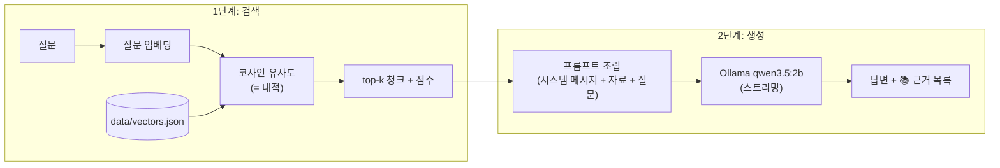

# Logic Pro 신스 RAG 챗봇

## 1. 소개

Logic Pro로 신스웨이브·신스팝을 만들려는 입문자가 "이런 소리는 뭘로 내?"라고 물으면, 애플 공식 설명서를 근거로 10개 항목 중 알맞은 것을 출처와 함께 안내하는 로컬 RAG 챗봇입니다.

- 다루는 10개 항목
  - 악기 5개: Retro Synth, ES2, Alchemy, EVP88, Drum Machine Designer
  - MIDI FX 1개: Arpeggiator
  - 이펙트 4개: Chorus, Rotor Cabinet, Space Designer, ChromaVerb
- 답하지 않는 것: 장르별 추천, 노브 수치, 작곡·편곡·믹싱 조언, 10개 외 플러그인, 다른 프로그램. 이런 질문에는 설명서에 적힌 기능 설명만 안내한다고 말하고, Logic Pro 앱이나 공식 설명서에서 확인하라고 안내합니다. (다만 2B 모델은 이 규칙을 항상 지키지는 못합니다. 7·8장 참고)
- 자료는 Logic Pro 12.3 설명서 기준이고, 내 앱은 12.4입니다(12.4 설명서는 없음).
- EVP88은 현재 설명서에서 Vintage Electric Piano라는 이름으로 나옵니다.

## 2. 동작 원리



1. 1단계: 질문을 임베딩해, 미리 만들어 둔 청크 벡터(`data/vectors.json`)와 코사인 유사도(정규화된 벡터라 내적)를 계산합니다.
2. 점수 순으로 top-k(기본 3)를 돌려주고, 1위가 `WEAK_THRESHOLD`(0.55) 미만이면 "관련 자료가 약함"으로 표시합니다(결과는 버리지 않음).
3. 2단계: 질문과 찾은 청크를 시스템 메시지, 근거 원칙, 출처 규칙과 함께 프롬프트로 조립합니다.
4. 조립한 프롬프트를 Ollama의 qwen3.5:2b에 보내고, 답변을 스트리밍으로 바로 출력합니다.
5. 근거 표시는 LLM에 맡기지 않습니다. LLM에게 넘긴 자료를 모두 보여 주고, 답변에 ID 글자가 들어 있는 자료에 ✓를 붙입니다.

## 3. 사용 기술

- 실행 환경: Node.js (PowerShell에서 실행)
- 임베딩: transformers.js, `onnx-community/embeddinggemma-300m-ONNX` (q8, 768차원, 공식 프롬프트 형식)
  - 문서: `"title: " + section + " | text: " + text`
  - 질문: `"task: search result | query: " + question`
- LLM: Ollama `qwen3.5:2b`

## 4. 실행 방법

준비:

```powershell
ollama pull qwen3.5:2b
npm install
```

인덱스 만들기(청크 벡터 생성):

```powershell
node src/build-index.mjs
```

1단계 검색만 보기:

```powershell
node src/search.mjs "질문"
```

1단계 + 2단계(검색 후 LLM 답변):

```powershell
node src/ask.mjs "질문"
```

`ask.mjs` 옵션:

| 옵션 | 설명 |
|---|---|
| `--k N` | 가져올 자료 개수(기본 3) |
| `--show-prompt` | LLM에 보낼 시스템 메시지와 프롬프트를 출력하고 끝냄. Ollama 없이도 동작 |
| `--no-rag` | 검색 없이, 시스템 메시지도 빼고 질문만 LLM에 보냄. RAG가 있을 때와 비교하는 실험용 |

주의사항:

- `ask.mjs`는 질문을 1개만 받습니다(`search.mjs`는 여러 개 가능).
- PowerShell에서 한글이 깨지면 먼저 `[Console]::OutputEncoding = [Text.Encoding]::UTF8`을 실행하세요.
- 첫 실행은 임베딩 모델을 다운로드합니다.

## 5. 자료

`data/chunks.json`의 청크 15개입니다.

| id | section | 출처 |
|---|---|---|
| LP-001 | Retro Synth - 개요 | https://support.apple.com/ko-kr/guide/logicpro/lgsi213c43b3/mac |
| LP-002 | Retro Synth - 엔진 선택 | https://support.apple.com/ko-kr/guide/logicpro/lgsi213c43b3/mac |
| LP-003 | ES2 - 합성 방식과 오실레이터 | https://support.apple.com/ko-kr/guide/logicpro/lgsia12923e/mac |
| LP-004 | ES2 - 모듈레이션 | https://support.apple.com/ko-kr/guide/logicpro/lgsia12923e/mac |
| LP-005 | Alchemy - 합성 엔진 | https://support.apple.com/ko-kr/guide/logicpro/lgsi2618652a/mac |
| LP-006 | Alchemy - 소스와 신호 흐름 | https://support.apple.com/ko-kr/guide/logicpro/lgsi2618652a/mac |
| LP-007 | EVP88 - 이름 변경 | https://support.apple.com/en-au/guide/logicpro/lgcpcdc45bd2/10.6.2/mac/10.15.7 |
| LP-008 | EVP88(Vintage Electric Piano) - 시뮬레이션 대상과 사운드 엔진 | https://support.apple.com/ko-kr/guide/logicpro/lgsifc1ba323/mac |
| LP-009 | Drum Machine Designer - 패드와 노트 분배 | https://support.apple.com/ko-kr/guide/logicpro/lgcpdcdd1d7a/mac |
| LP-010 | Arpeggiator - 개요 | https://support.apple.com/ko-kr/guide/logicpro/lgce2f607310/mac |
| LP-011 | Arpeggiator - Smart Controls에서 켜기 | https://support.apple.com/ko-kr/guide/logicpro/lgcp93ac1284/mac |
| LP-012 | Chorus - 동작 원리 | https://support.apple.com/ko-kr/guide/logicpro/lgcef266d395/mac |
| LP-013 | Rotor Cabinet - 개요와 기본 파라미터 | https://support.apple.com/ko-kr/guide/logicpro/lgcef266d84d/mac |
| LP-014 | Space Designer - 컨볼루션 리버브 | https://support.apple.com/ko-kr/guide/logicpro/lgce357aa791/mac |
| LP-015 | ChromaVerb - 공간 유형과 보기 | https://support.apple.com/ko-kr/guide/logicpro/lgcp18cc0940/mac |

청크 설계 원칙:

1. 사실 하나만 담는다.
2. 혼자 읽어도 뜻이 통한다.
3. 원문에 없는 말을 보태지 않는다.

설명서를 통째로 복사하지 않고 한국어로 요약했습니다.

버전 메모: LP-007만 10.6.2판 영어 페이지가 출처이고, 나머지는 12.3 한국어판입니다.

## 6. 1단계 관찰 기록

`node src/search.mjs`로 직접 실행해 본 질문 21개의 결과입니다. k=3, `WEAK_THRESHOLD`=0.55. 점수는 실행 결과에 나온 값(소수점 셋째 자리)을 그대로 옮겼고, 유형 분류는 실행 뒤에 붙인 것입니다. (출처: `docs/step5-observations.md`)

| # | 질문 | 유형 | 1위 id | 1위 점수 | 2·3위 id와 점수 | ⚠ | 관찰 |
|---|---|---|---|---|---|---|---|
| 1 | Retro Synth는 어떤 엔진을 제공해? | 정상 | LP-001 | 0.801 | LP-002 0.756 / LP-008 0.595 | 없음 | 항목명이 들어간 질문은 1·2위가 모두 정답 항목이고 가장 높은 점수가 나옴 |
| 2 | Wavetable 신스 소리를 내고 싶어 | 다른 표현 | LP-002 | 0.678 | LP-001 0.631 / LP-003 0.607 | 없음 | 항목명 없이도 Retro Synth 청크 둘이 1·2위로 올라옴 |
| 3 | EVP88이 뭐야? | 정상 | LP-008 | 0.655 | LP-007 0.629 / LP-003 0.496 | 없음 | EVP88 청크 둘이 1·2위, 3위부터 0.496으로 떨어짐 |
| 4 | Vintage Electric Piano는 어떤 피아노를 시뮬레이션해? | 정상 | LP-008 | 0.757 | LP-007 0.563 / LP-002 0.514 | 없음 | 정답 LP-008이 1위, 2위와 0.19 차이 |
| 5 | 코드를 한 음씩 쪼개서 연주하려면 뭘 써? | 다른 표현 | LP-010 | 0.621 | LP-012 0.565 / LP-009 0.557 | 없음 | 정답(Arpeggiator)이 1위지만 2·3위도 임계값 위 |
| 6 | 레슬리 스피커처럼 빙글빙글 도는 소리 | 다른 표현 | LP-013 | 0.639 | LP-014 0.560 / LP-003 0.555 | 없음 | 정답(Rotor Cabinet)이 1위, 2·3위는 무관한 항목 |
| 7 | 소리를 두껍게 하고 싶어 | 경계 | LP-012 | 0.562 | LP-014 0.554 / LP-013 0.553 | 없음 | 1–3위가 0.553–0.562로 거의 같음, 임계값을 간신히 넘음 |
| 8 | 리버브 두 개 차이가 뭐야? | 경계 | LP-015 | 0.593 | LP-014 0.535 / LP-013 0.511 | 없음 | 두 리버브가 1·2위지만 2위는 임계값 아래, 비교하려면 k를 키워야 함 |
| 9 | 드럼 머신 같은 소리는 뭘로 내? | 다른 표현 | LP-013 | 0.589 | LP-002 0.578 / LP-009 0.574 | 없음 | 오검색: 정답 LP-009가 3위, 1–3위 차이 0.015 |
| 10 | ES2에 내장된 이펙트는 뭐가 있어? | 자료에 없음 | LP-003 | 0.703 | LP-004 0.677 / LP-013 0.545 | 없음 | 내장 이펙트 청크가 없는데 ES2 이름 때문에 높은 점수로 통과 |
| 11 | 신스웨이브 베이스는 어떻게 만들어? | 비목표 | LP-003 | 0.545 | LP-002 0.543 / LP-001 0.508 | ⚠ | 장르 질문, 1–2위 차이 0.002이고 임계값 바로 아래 |
| 12 | Retro Synth Cutoff 몇으로 맞춰? | 비목표 | LP-001 | 0.687 | LP-002 0.658 / LP-013 0.516 | 없음 | 노브 수치 질문인데 항목명 때문에 높은 점수로 통과 |
| 13 | 내일 날씨 어때? | 무관 | LP-002 | 0.399 | LP-015 0.398 / LP-003 0.393 | ⚠ | 1–3위가 0.39대로 전부 낮음 |
| 14 | 김치찌개 레시피 알려줘 | 무관 | LP-014 | 0.384 | LP-003 0.378 / LP-006 0.372 | ⚠ | 1–3위가 0.37–0.38로 가장 낮음 |
| 15 | Pro Tools에서 녹음하는 법 알려줘 | 비목표 | LP-013 | 0.539 | LP-014 0.528 / LP-002 0.525 | ⚠ | Logic 외 프로그램, 임계값 바로 아래 |
| 16 | EQ로 보컬을 맑게 만드는 법 | 자료에 없음 | LP-012 | 0.557 | LP-003 0.530 / LP-008 0.503 | 없음 | 다루지 않는 이펙트인데 임계값을 0.007 넘겨 통과 |
| 17 | Logic Pro 가격이 얼마야? | 자료에 없음 | LP-007 | 0.520 | LP-011 0.478 / LP-014 0.472 | ⚠ | 오검색: LP-007 본문의 "Logic Pro" 단어 겹침으로 1위 |
| 18 | 기타 앰프 소리를 만들고 싶어 | 자료에 없음 | LP-013 | 0.581 | LP-003 0.550 / LP-006 0.544 | 없음 | 해당 항목이 없는데 Rotor Cabinet이 0.581로 통과 |
| 19 | Alchemy가 뭐야? | 정상 | LP-005 | 0.713 | LP-006 0.648 / LP-015 0.451 | 없음 | Alchemy 청크 둘이 1·2위, 3위는 0.451로 크게 떨어짐 |
| 20 | Chorus가 뭐야? | 정상 | LP-012 | 0.740 | LP-015 0.505 / LP-010 0.479 | 없음 | 정답이 1위, 2위와 0.235 차이 |
| 21 | Space Designer가 뭐야? | 정상 | LP-014 | 0.728 | LP-009 0.508 / LP-015 0.491 | 없음 | 정답이 1위, 2위와 0.220 차이 |

### 생각해 볼 것

- **다른 표현:** Wavetable 0.678, 레슬리 스피커 0.639, "코드를 한 음씩 쪼개서"도 1위가 맞았다. 영어 이름이나 표현이 달라도 단어가 아니라 뜻으로 찾는다.
- **자료에 없는데 점수가 높음:** ES2 내장 이펙트 0.703, Cutoff 0.687이 ⚠ 없이 통과했다. 검색은 가장 가까운 것을 고를 뿐 답이 있는지는 모르므로 2단계 LLM 규칙이 필요하다.
- **기준값 0.55:** 막연한 정상 질문(0.56–0.59)과, 항목 이름이 들어가지 않은 자료 밖 질문(0.52–0.58)이 겹쳐 점수 하나로 가를 수 없었다. 항목 이름이 들어간 자료 밖 질문(ES2 내장 이펙트 0.703, Cutoff 0.687)은 오히려 더 높게 나왔다. 그래서 0.55를 유지했다.
- **엉뚱한 끌림:** "드럼 머신 같은 소리"는 1위가 Rotor Cabinet(0.589)이고 정답 LP-009는 3위(0.574)였다. "Logic Pro 가격"은 "Logic Pro"라는 단어가 본문에 있는 LP-007로 끌렸다.

## 7. 2단계 비교 실험 기록

같은 질문을 `--no-rag`(RAG 없이)와 RAG로 각각 실행해 비교했습니다.

| 질문 | RAG 없이 (핵심) | RAG (핵심) | [LP-xxx] 표시 | 지어낸 내용? | 내 판단 |
|---|---|---|---|---|---|
| 코드를 한 음씩 쪼개서 연주하려면? | Tone.js·Web Audio API 코드를 소개 | Arpeggiator | [LP-010] | 없이: 질문과 무관한 답 | RAG가 맞음 |
| Retro Synth에는 어떤 엔진이? | "Synthesia 오픈소스, VST3/VST2" | Analog, Sync, Wavetable, FM | [LP-001] | 없이: 예 | RAG가 맞음 |
| ChromaVerb 공간 유형 수? | 4개 | 14개 | [LP-015] | 없이: 예(수치 틀림) | RAG가 맞음 |
| Alchemy 소스 수? | 32개(모바일 게임 이야기) | 최대 4개(A~D) | [LP-006] | 없이: 예(수치 틀림) | RAG가 맞음 |
| Cutoff를 몇으로? | "300Hz로 시작" | "제가 가진 자료에는 없습니다" | [LP-001](잘못 표기됨) | 없이: 예(수치 지어냄) | RAG가 맞음(수치를 내지 않음). 단 ✓는 근거가 아니고, 시스템 메시지가 시킨 '앱·설명서에서 확인하라'는 안내는 빠졌으며 지시문을 되읽는 문장('…라고 답변해야 합니다')이 섞임 |

### 비목표 질문 시험 결과

- Cutoff, ES2 내장 이펙트, 날씨: 모두 "자료에 없다"로 거절했습니다.
- 신스웨이브 베이스: ES2를 소개했습니다. LP-003의 "베이스에 적합" 서술에 근거한 답이라 지어낸 내용은 아니지만, "장르별 추천은 하지 않는다"는 규칙은 따르지 않았습니다. 약한 근거 ⚠는 유지됐습니다.

### 선택 실험

시스템 메시지에 "장르 이름이 들어간 질문에는 첫 문장에서 '장르별 추천은 하지 않습니다'라고 말한 뒤 자료에 적힌 소리 특성만 안내합니다"를 추가했지만 출력이 바뀌지 않았습니다. 계약은 그대로 두고 `git restore`로 되돌렸습니다.

## 8. 한계와 다음 단계

한계:

- 2B 모델은 시스템 메시지의 긴 규칙 일부를 따르지 못한다.
- 검색 점수만으로 "답이 없음"을 판단하기 어렵다(ES2 0.703, Cutoff 0.687).
- ✓는 "답변에 ID 글자가 있다"는 뜻이지 근거로 쓰였다는 보증이 아니다.
- 1위만 보는 기준이라 2–3위의 잡음 자료는 걸러지지 않는다.
- LP-009(Drum Machine Designer)는 목적 설명이 없어 "드럼 머신 같은 소리" 질문에서 못 찾는다.
- 자료는 12.3 기준이라 내 앱(12.4)과 다를 수 있다.
- 항목 이름이 영어, 질문이 한국어라 표현 차이에 민감하다.
- RAG 답도 숫자를 잘못 옮길 수 있어 📚 근거 원문과 대조해야 한다.
- 거절할 때 시스템 메시지가 시킨 안내 문구('Logic Pro 앱이나 공식 설명서에서 확인')를 빠뜨리거나, 지시문을 그대로 되읽는 어색한 문장이 섞인다.

다음에 해 볼 것:

- ES2 내장 이펙트·Drum Machine Designer 개요 청크를 추가하고 전·후 비교
- BM25 하이브리드 검색
- 1위와 2위의 점수 차를 신호로 쓰기
- 대화형 모드

## 9. 설계 결정

- 주제는 내가 실제로 쓰고 앱으로 직접 확인할 수 있는 분야(Logic Pro)로 골랐고, 출처는 신뢰할 수 있는 공식 설명서로 삼았다. 직접 검증할 수 없는 자료는 쓰지 않았다.
- 출처는 애플 공식 설명서로 삼았고, 내가 직접 쓰는 별도 문서는 만들지 않았다(쓸 만한 사용 경험이 아직 부족해서).
- `WEAK_THRESHOLD`를 0.55로 유지한 근거는 6번(관찰 기록)의 "기준값 0.55" 항목이다.
- 시스템 메시지는 직접 썼고, "비목표" 같은 내부 용어 대신 구체 목록으로 고쳤다.
- 프롬프트 ④ 현재 시각은 Logic 질문에 필요 없지만 계약 변경 비용 때문에 유지했다.

## 제출 정보

- Node.js 버전: v24.19.0
